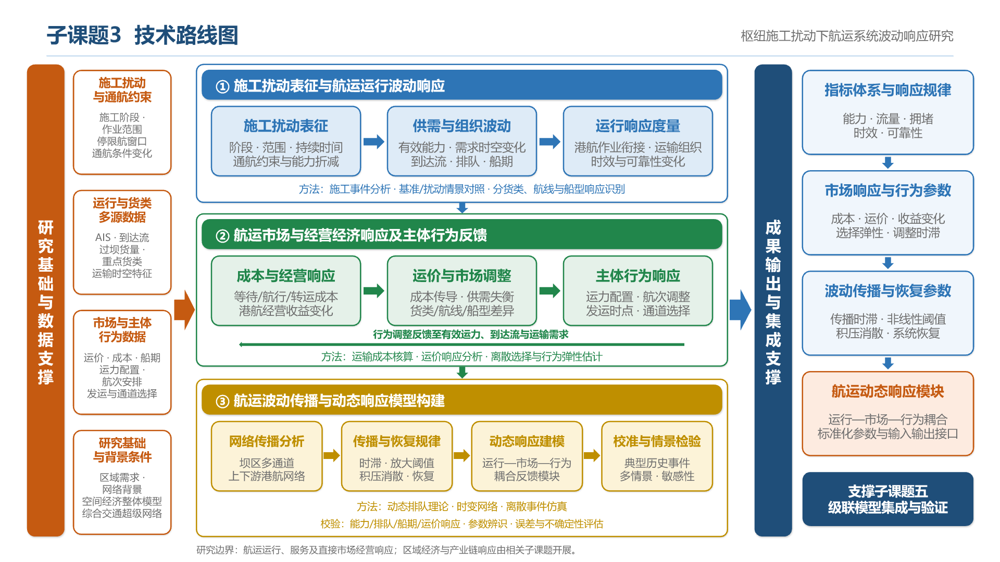

# 子课题三研究方案与申报材料汇编

本子课题隶属于“三峡水运新通道数智增效”项目1.5的课题一，研究枢纽施工扰动对航运运行、运输服务及直接市场经营的动态影响，形成供“枢纽施工—航运波动—产业链响应”级联模型调用的航运响应模块。本文汇集项目背景、任务边界、申报表述、详细研究设计、子课题衔接、技术路线与国内外研究参考，供研究分工和申报材料编制使用。

## 一 项目及课题设置

### 1.1 项目与本人承担任务

- **项目题目：** 三峡水运新通道数智增效
- **项目1.5：** 联运协同智能决策技术及平台研发
- **本人负责课题：** 课题一——研究揭示航运组织与产业运输需求动态适配规律，融合重点货类结构等多源数据，构建“枢纽施工-航运波动-产业链响应”级联影响传播模型。
- **本人主要负责子课题：** 子课题三——枢纽施工扰动下航运系统波动响应研究。

### 1.2 项目1.5主要研究内容及工作基础

#### 1.2.1 航运组织与产业运输需求动态适配及级联影响传播模型

**研究内容：** 研究揭示航运组织与产业运输需求动态适配规律，融合重点货类结构等多源数据，构建“枢纽施工-航运波动-产业链响应”级联影响传播模型。

**工作基础：** 长江经济带空间经济-土地利用-综合交通整体规划模型。

#### 1.2.2 多动态扰动场景下的区域航运需求智能预测

**研究内容：** 研发适配施工扰动、通航条件变化、货类运输时空特征及级联影响等多动态扰动场景的区域航运需求智能预测技术。

**工作基础：** 长江经济带空间经济-土地利用-综合交通整体规划模型可以开展相关级联影响效果预测。

#### 1.2.3 复杂扰动下的货流分配与运输组织优化

**研究内容：** 研究复杂扰动下多通道、多模式货流分配与运输组织优化方法，构建考虑运输资源能力约束、适配施工期运输组织协同的多式联运耦合网络优化模型。

**工作基础：** 综合交通超级网络模型可以用来模拟相关多式联运耦合网络优化技术的潜在效果。

#### 1.2.4 多情景推演运输方案智能分析决策

**研究内容：** 研建考虑突发拥堵、船期波动和作业调整等情景下的面向港口运营、船闸调度和货主需求协同的多情景推演运输方案智能分析决策技术。

**工作基础：** 集成宏-中-微观仿真技术的综合交通超级网络模型可以用来实现多情景推演运输方案智能分析决策技术。

#### 1.2.5 一体化运行监测与决策体系及动态推演平台

**研究内容：** 构建“感知-预警-调度-评估”一体化运行监测与决策体系，研发物流运行数字化动态推演平台，并开展施工期应用验证。

**工作基础：** 开发可以融合实时输入数据的“高保真”宏-中-微观仿真技术的综合交通超级网络仿真模型，构建考虑以上各方面动态信息的物流运行数字化动态推演平台。

### 1.3 课题一研究内容

本人负责课题一，其研究内容为：

> 研究揭示航运组织与产业运输需求动态适配规律，融合重点货类结构等多源数据，构建“枢纽施工-航运波动-产业链响应”级联影响传播模型。

课题一的工作基础为**长江经济带空间经济-土地利用-综合交通整体规划模型**。

### 1.4 课题一子课题设置

| 编号 | 子课题名称 | 本人承担情况 |
| --- | --- | --- |
| 子课题一 | 基于多源异构数据的“枢纽-航运-产业”耦合系统特征及动态演进研究 | 所负责课题一的组成部分 |
| 子课题二 | “枢纽施工-航运波动-产业链响应”级联影响机理分析 | 所负责课题一的组成部分 |
| 子课题三 | 枢纽施工扰动下航运系统波动响应研究 | **本人主要负责** |
| 子课题四 | 基于级联影响传播模型的长江经济带“航运枢纽施工-航运能力波动-产业链响应”分析与应用 | 所负责课题一的组成部分 |
| 子课题五 | 面向三峡坝区多通道影响的“枢纽施工-航运波动-产业链响应”级联影响传播模型构建与验证 | 所负责课题一的组成部分 |

## 二 子课题三题目与研究定位

**确定题目：枢纽施工扰动下航运系统波动响应研究。**

原题目“枢纽施工扰动下航运系统运输能力与需求波动响应研究”以运输能力和需求为主线，主要关注供需规模、时空分布及适配关系。现题目将研究对象扩展为航运系统的整体动态响应，除能力与需求外，还涵盖排队积压、运输组织、港航作业衔接、船期、时效可靠性、直接市场与经营经济响应及系统恢复。保留现题目，通过任务边界限定研究范围，避免将区域经济、完整产业链建模和项目平台研发全部纳入本子课题。

本子课题主要回答：枢纽施工在什么条件下、通过什么过程引起多大幅度、多长时间和多大空间范围的航运波动，航运主体如何调整，系统何时恢复。研究成果应形成可解释、可校准、可供全链条模型调用的航运动态响应模块。

**研究边界：** 聚焦航运系统内部运行、运输服务及与施工直接相关的市场和经营经济响应，研究有效运输能力、运输需求、排队拥堵、运输组织、时效可靠性，以及成本、运价、经营收益和主体行为的动态变化及反馈。产业库存、生产调整、产业链损失及区域经济效应由相关子课题衔接研究；完整级联模型集成与整体验证由子课题五承担。

纳入市场与经营经济响应，是为了解释运输交易及港航经营变化如何反馈到运力、到达流、需求和恢复过程。货主发运、通道及运输方式选择属于运输行为响应；库存与生产决策作为产业响应接口。各模块需统一费用口径，避免把企业成本、货主支付运费和企业收入重复计为经济损失。

## 三 子课题三申报书核心表述

### 3.1 研究介绍

枢纽施工扰动下航运系统波动响应研究方面，船闸服务过程仿真、检修期船舶调度、航运成本核算及市场监测等研究，为施工期航运响应分析提供了方法基础。已有相关成果分别关注通航条件、排队等待、通过效率或运价变化，面向三峡坝区多通道施工情景，仍需将施工约束、有效能力、货流组织、运输服务与市场行为反馈联动研究。重点应从施工参数化与运行影响识别出发，揭示不同货类、航线和船型的差异化响应，研究波动传播时滞、非线性放大阈值、积压消散与恢复规律，构建经典型事件校准和多情景检验的航运动态响应模型，为全链条级联影响传播研究提供模块与参数支撑。相关研究依据见第七部分。

### 3.2 主要研究内容精简概述

研究施工扰动下航运能力、需求、运输组织及服务水平的动态变化，揭示成本、运价与主体行为调整的反馈作用，构建航运波动传播与动态响应模型，识别传播时滞、放大阈值及恢复规律，为级联影响传播模型提供模块与参数支撑。

### 3.3 主要研究内容逐条表述

**①施工扰动表征与航运运行波动响应**

研究枢纽施工阶段、作业时空分布及通航约束的扰动特征，分析有效运输能力、运输需求与组织方式的动态变化；融合重点货类运输时空特征，揭示船舶到达、排队积压、船期偏移及港航作业衔接的响应规律，建立涵盖能力、流量、拥堵、时效与可靠性的波动响应指标体系。

**②航运市场与经营经济响应及主体行为反馈**

研究施工扰动引起的运输成本、运价及港航经营收益变化，分析不同货类、航线和船型的差异化响应；量化航运企业运力配置、航次安排与货主发运时间、通道选择等行为调整，建立“运行波动—市场调整—行为响应”的动态反馈关系，揭示市场适应对航运供需失衡与运行波动的影响。

**③航运波动传播与动态响应模型构建**

基于动态排队理论、时变网络与离散事件仿真，研究航运波动在坝区多通道及上下游港航网络中的传播过程，识别传播时滞、非线性放大阈值及积压消散与系统恢复规律；构建融合运行与市场行为反馈的航运动态响应模型，开展典型事件校准与多情景检验，为级联影响传播模型提供模块、参数及接口支撑。

### 3.4 拟解决的问题与拟采用的方法

针对枢纽施工扰动下航运运行波动难以准确识别、市场与主体行为反馈难以量化、局部扰动向多通道及上下游网络的传播过程难以刻画等问题，融合施工记录、船舶自动识别系统轨迹、通航运行、重点货类、港口作业及运价成本等数据，采用施工事件分析与基准情景对照方法，建立施工强度、持续时间及空间范围向有效通航能力与组织约束的量化映射。基于动态排队理论、时变网络及离散事件仿真，刻画船舶到达、船闸服务、排队积压、船期偏移与港航衔接的动态过程；结合运输成本核算、运价响应分析及离散选择模型，量化运力配置、航次安排、发运时点和通道选择的行为调整，构建“运行波动—市场调整—行为响应”反馈关系。依托综合交通超级网络提供的网络与仿真基础，建立航运动态响应模块，通过典型事件参数辨识、独立事件检验和敏感性分析，识别传播时滞、非线性放大阈值及恢复规律，形成可供级联模型调用的参数与标准化接口。

### 3.5 可行性分析

本子课题以施工期通航条件变化及重点货类运输需求为驱动，从施工扰动参数化、航运运行响应识别、市场与主体行为反馈建模和网络波动传播分析出发，构建航运动态响应模型。已有长江经济带空间经济—土地利用—综合交通整体规划模型可提供区域需求与网络背景，综合交通超级网络可提供多通道联系及仿真基础；动态排队、时变网络、离散事件仿真和运输选择建模可分别支撑运行过程与行为反馈分析。通过施工记录、港航运行及市场数据校准模型，利用典型事件与多情景检验验证响应规律，形成航运模块向全链条模型的接口。研究路径具有可实施性，具体实施需落实数据可获取性，补充坝区设施、船闸服务和船舶运行的精细表达，并核实既有模型的时间分辨率与校准能力。

### 3.6 先进性分析

本子课题将施工约束、航运运行、运输服务与市场行为反馈纳入统一的动态响应框架，结合多源运行数据和分货类、航线、船型分析，研究不同初始负荷及替代条件下的响应差异。基于动态排队、时变网络与离散事件仿真，联动刻画局部能力变化、网络传播和主体适应，识别时滞、阈值及恢复过程；通过典型事件校准、多情景检验与不确定性评估，增强模型的解释性和跨情景适用能力。相较分别分析通航效率、需求变化或市场价格的研究路径，拟形成贯通运行与行为反馈、可嵌入级联模型的模块化研究方法，其先进性需通过与相关方法的对照检验予以验证。

### 3.7 涉及的科学问题与技术问题

子课题三拟解决的核心科学问题是：枢纽施工形成的时变通航约束如何引起航运能力、货流组织与运输服务的波动，成本、运价及主体行为调整如何反馈作用于航运供需，并影响波动在坝区多通道和上下游港航网络中的传播、放大与恢复。重点揭示上述过程的非线性耦合关系、响应时滞及临界阈值。拟突破的关键技术问题是：区分施工扰动与常态运行波动，建立施工约束向航运响应的量化映射，构建融合运行状态与市场行为反馈的动态响应模型，实现多源数据驱动的参数辨识、模型校准与多情景检验，为级联影响传播模型提供航运响应模块及标准化接口。

### 3.8 创新点

提出枢纽施工扰动下“运行波动—市场调整—主体行为”耦合反馈建模方法，将时变通航约束与运力配置、发运及通道选择行为联动，揭示航运波动跨通道传播的时滞、非线性放大阈值与恢复规律，形成可嵌入级联影响传播模型的航运动态响应模块。

## 四 子课题三详细研究设计

### 4.1主要研究内容一 施工扰动的分类 参数化与情景表达

首先需要把施工安排转换为模型可以使用的外部输入。重点研究施工阶段、影响位置、持续时间、作用强度与通航约束之间的对应关系。

| 研究维度 | 建议刻画内容 | 对航运系统的直接作用 |
| --- | --- | --- |
| 时间特征 | 施工起止时间、阶段切换、每日作业窗口、间歇限制及恢复安排 | 改变可用通航时段及其连续性 |
| 空间特征 | 受影响通道、关键节点、连接航段及局部作业水域 | 改变网络可达性和局部通行条件 |
| 能力特征 | 可用设施数量、服务速率、有效作业时间、船型适用范围 | 改变不同船型和时段的有效服务能力 |
| 组织特征 | 通行批次、放行节奏、优先规则、交通管制和作业协同规则 | 改变排队顺序、服务时间和船舶到达节奏 |
| 不确定性特征 | 工期变化、临时停工或延长、能力恢复偏差 | 形成波动范围和尾部延误风险 |

以上均是需要依据实际工程方案核实的候选扰动类型，不代表已确定的施工安排。情景应包含无施工基准、典型施工阶段、不同强度与持续时间的施工扰动，以及施工与水文变化、需求高峰或突发事件叠加的情景。

**核心成果：** 施工扰动分类体系、参数化表达方法和施工情景库，明确每个施工参数如何改变航运网络中的能力或组织约束。

### 4.2 主要研究内容二 航运波动响应指标与施工影响识别

建立能够同时描述运行状态、服务质量和恢复过程的指标体系，并确定各指标的时间尺度、空间尺度及数据来源。

| 指标类别 | 建议指标 | 研究意义 |
| --- | --- | --- |
| 通航能力 | 有效通过能力、能力损失幅度、通道可用时间 | 描述施工对航运供给的约束 |
| 运行负荷 | 船舶到达量、实际通过量、货运量、能力利用水平 | 区分运输需求、实际实现流量与瓶颈负荷 |
| 拥堵状态 | 排队船舶数、积压货量、等待时间分布、拥堵持续时间 | 描述供需失衡的累积过程 |
| 运输服务 | 全程运输时间、船期偏差、运输时间离散程度、按约定时限到达比例 | 描述时效及可靠性损失 |
| 空间传播 | 受影响航段和港口、上下游波动时滞、影响距离或网络范围 | 描述局部扰动向网络的扩散 |
| 组织适应 | 发运时间调整比例、通道选择变化、转运或改道比例 | 描述参与主体的适应行为 |
| 市场与经营经济 | 分货类和航线运价、单航次成本、单位运输成本、船舶周转率、经营收益变化 | 描述施工引起的市场调整及其对供需和组织行为的反馈 |
| 恢复韧性 | 最大性能损失、积压消散时间、恢复时间、累计服务损失 | 描述冲击承受和恢复能力 |

特别需要区分**设计或名义能力、实际有效能力、实际通过量和潜在运输需求**。施工后通过量下降，可能来自能力降低，也可能来自货主主动延后发运；通过量短期保持稳定，也不意味着没有影响，可能已经出现更长等待时间和更大积压。

施工影响识别应以反事实基准为核心：比较相同或可比需求、水文、季节及运行规则下，“有施工”和“无施工”的系统表现。根据数据条件，可采用匹配时段比较、事件研究、具备适用条件的准实验分析或经过校准的仿真对照。历史数据分析需控制水文、天气、季节性需求、节假日及非施工管制等共同变化；仿真分析需明确结果依赖的假设，不能将模型情景差异直接视为已证实的现实因果效应。

**核心成果：** 航运响应指标体系、施工影响识别方法及不同扰动条件下的响应特征，给出响应幅度、时滞和不确定性范围。

### 4.3 主要研究内容三 能力变化 排队积压与网络波动传播

这一部分是子课题三的定量研究主体，需要解释施工扰动如何从局部通航约束转化为系统运行波动。

1. **施工约束向有效能力的转化。** 研究设施可用性、通行时段、船型组合和组织规则共同决定有效能力的方式，避免仅用固定比例折减能力。相同施工强度在不同负荷与组织条件下可能产生不同后果，应分析这种条件依赖关系。
2. **到达—服务失衡与积压演化。** 研究到达需求超过有效服务能力时的排队增长、等待时间和积压货量变化，以及恢复后积压消散的过程。对分时段、分船型、分方向的情况，应考虑相应的服务约束和队列组织规则。
3. **局部波动向上下游的传播。** 研究坝区放行节奏变化如何影响下游船舶集中到达、上游待闸积压、港口装卸负荷和后续航次安排，识别传播方向、时间滞后及波动放大或衰减条件。
4. **多通道之间的波动转移。** 在实际可行的替代通道和转运条件下，研究一个通道受限后运输需求如何转移、其他节点能否承接，以及是否产生新的瓶颈。替代能力应受连接条件、货类适配性、作业资源和运输成本等约束。
5. **阈值、非线性与恢复滞后。** 分析系统从可消化扰动转为持续积压的临界条件，并研究施工结束后恢复为何可能滞后。还应检验多次短时限制是否会因积压未消散而累积为更大冲击。

一个用于说明研究逻辑的简化排队关系是：

\[
Q_{t+1}=\max\{0,\ Q_t+A_t-C_t\}
\]

其中，`Q_t` 为时段开始时的积压量，`A_t` 为该时段新增到达量，`C_t` 为施工和运行条件下该时段可提供的有效服务量；三者应采用一致单位。该关系说明能力恢复并不必然立即消除积压，消散速度取决于恢复后剩余服务能力。它仅是单队列、离散时段的逻辑示意，正式模型还需考虑时段内到达、船型差异、批次服务、优先规则和网络反馈。

**核心成果：** 施工扰动—有效能力—排队积压—网络传播的动态响应模型，以及关键阈值、传播时滞和恢复规律。

### 4.4 主要研究内容四 重点货类与运输组织的差异化响应

课题一强调航运组织与产业运输需求的动态适配，因此子课题三不能只以船舶总量为研究对象，还应研究不同货类和运输组织方式的响应差异。

建议以项目实际确定的重点货类为对象，刻画其运输批量、发运节奏、船型需求、交付期限、可延期程度及替代运输条件。分析同一施工扰动对不同货类的等待时间、运输费用、交付可靠性和可实现运输量产生的差异，并研究货主与航运企业如何调整发运时间、航次安排和通道选择。

这里需要建立双向联系：一方面，航运能力与时效变化影响运输安排；另一方面，提前发运、延后发运或集中恢复发运又会改变船舶到达过程，影响拥堵和恢复。因此，模型应在数据支持的范围内考虑需求调整反馈，而不是始终将到达需求设定为不变。

**任务边界：** 子课题三重点量化货物运输环节的变化，形成按货类、起讫点和时段划分的运输时间、运输费用、可靠性及可实现运输量等输出。库存变化、生产调整、投入产出关系、产业链损失和区域经济效应应与子课题二、四、五衔接，不在本子课题中重复开展完整产业链建模。

**核心成果：** 分货类的航运响应参数、运输组织适应规律，以及连接航运响应与产业响应的接口变量。

### 4.5 主要研究内容五 航运市场与经营经济响应及运行反馈

研究与施工扰动直接相关的运输成本、运价、经营收益及主体行为变化，形成“运行变化—市场调整—行为响应—运行反馈”的定量联系。

1. **运输成本响应。** 量化待闸、港口等待、周转下降、绕行及转运对单航次和单位货物运输成本的影响，区分承运企业的运营成本与货主实际支付的运输价格。
2. **运价响应。** 按货类、航线、船型及合同条件识别运价变化幅度与时滞，分析有效运力、运输需求和替代条件的共同作用。能力下降是否推高运价，应作为待检验关系，并控制需求季节性、燃料价格等其他因素。
3. **经营与运力配置响应。** 分析成本和收益变化如何影响承运意愿、航次安排、船舶调配及货类选择；根据数据条件，识别相关港口作业量与资源利用变化引起的直接经营影响。
4. **货主运输选择响应。** 分析运价、时效与可靠性变化如何影响提前或延期发运、通道选择及替代运输方式，估计可支持模型计算的行为参数。
5. **运行反馈。** 将主体调整转化为船舶到达、运输需求及可用运力的变化，检验市场调整何时缓解供需失衡、何时加剧集中到达或延长恢复过程。

重点反馈链条为：**施工扰动→能力与运行状态变化→成本、运价与收益变化→企业和货主行为调整→航运供需与运行状态再次变化。** 不预设反馈方向，应结合重点货类、替代条件和实际数据进行检验。

**核心成果：** 施工相关的成本与运价响应关系、运力及发运调整参数、航运内部市场反馈模块。指标需明确核算口径；企业成本、货主支付运费和企业收入不能简单相加为社会经济损失。

### 4.6 主要研究内容六 响应模型构建 校准与检验

建议采取“数据识别—机制建模—情景仿真—独立检验”的技术路线。模型复杂度应与研究问题和可获得数据相匹配。

- **数据识别：** 联合施工记录、通航运行记录、船舶轨迹、港口作业和货运数据，对齐时间与空间口径，识别能力变化、到达变化及其响应时滞。基础数据治理与公共数据集建设主要由子课题一统筹，本子课题提出航运响应分析所需的数据精度与字段要求。
- **机制建模：** 以动态排队、时变网络和运输组织行为为基础，刻画能力约束、积压演化与通道之间的相互影响；根据具体问题选择必要的统计或数据驱动方法辅助参数估计。
- **情景仿真：** 依托已有空间经济—土地利用—综合交通模型提供区域需求和网络背景，针对坝区通航、排队及船舶运行补充相应模块。若进一步使用综合交通超级网络及宏—中—微观仿真，需要核查其水运设施表达、时间分辨率和数据校准能力，不能仅凭既有模型名称认定已经具备施工期精细响应模拟能力。
- **参数校准：** 使用可获得的典型事件和运行数据校准能力、到达、服务时间、行为调整及传播参数，说明参数来源和可迁移范围。
- **独立检验：** 在数据量允许时，用不同事件或时段进行检验，避免仅在校准数据上报告拟合效果。关注通过量、排队长度、等待时间分布、波动时滞及恢复时间等多项指标。
- **不确定性分析：** 检验施工强度、工期、需求、水文和行为参数变化对结果的影响，报告情景范围、敏感因素与模型适用边界。

子课题三负责航运响应模块及相关参数的校准检验；子课题五负责将其嵌入完整级联传播模型，并开展全链条的一致性和整体有效性验证。

### 4.7 建议凝练的科学问题与成果

建议围绕三个问题组织申报论证：

1. **施工扰动如何通过有效能力与到达需求失衡形成航运波动，何种条件下出现非线性放大？** 重点解释扰动强度、持续时间、初始负荷和运输组织规则的联合作用。
2. **局部通航波动如何在多通道、港口与航段之间传播，其时滞、范围和恢复过程由什么决定？** 重点解释网络连接、节点剩余能力和积压状态对传播的影响。
3. **重点货类运输需求、市场调整与航运组织如何相互反馈，何种条件下能够缓解或加重波动？** 重点解释货类时间约束、替代条件、成本与运价变化及主体行为对运行状态的影响。

对应的建议成果包括：施工扰动参数化方法与情景库、航运波动响应指标体系、动态响应模型、重点货类及成本与运价响应参数集、主体行为反馈关系、传播阈值与恢复规律、典型事件检验报告，以及供子课题五集成的模块和接口说明。考核指标可围绕响应识别、关键运行指标误差、事件覆盖与模块可调用性设置；具体数值应依据数据条件和先导试验确定。

## 五 研究边界与子课题衔接

### 5.1子课题三研究边界

> **本子课题聚焦枢纽施工扰动下航运系统内部的运行、运输服务与市场及经营经济响应，研究有效运输能力、运输需求、排队拥堵、运输组织、时效可靠性以及运输成本、运价和主体行为的动态变化，揭示其相互反馈、波动传播与恢复规律；向产业链响应研究提供运输服务与市场变化输入。产业库存、生产调整、产业链损失及区域经济效应，由子课题二、四、五在全链条机理、应用分析和模型集成中衔接研究。**

| 边界维度 | 子课题三承担的任务 | 与其他任务衔接的内容 |
| --- | --- | --- |
| 数据与特征 | 提出航运响应所需字段和精度，开展施工事件分析及专业参数识别 | 子课题一统筹公共数据治理和耦合系统动态演进特征；市场数据复用共同底座 |
| 作用机制 | 定量研究航运内部的能力、需求、组织、服务与市场反馈 | 子课题二统筹施工—航运—产业跨系统因果路径与级联机理 |
| 经济层级 | 研究运输交易和港航经营层面的直接成本、价格、收益与行为响应 | 子课题四结合产业及区域结构分析库存、生产、产业链和空间经济效应 |
| 模型责任 | 研建并检验包含必要市场反馈的航运响应模块 | 子课题五负责全链条集成、跨尺度接口、产业需求反馈求解与整体验证 |
| 研究用途 | 识别施工影响、响应参数、传播阈值及恢复规律 | 项目1.5其他任务开展需求智能预测、运输优化、智能决策和平台研发 |

“航运经济”在本子课题中限定为与施工直接相关的运输成本及港航经营表现，不扩展为独立的区域经济影响或航运行业长期发展研究。货主的发运、运输路径和方式调整属于本子课题的行为响应；库存与生产决策则作为产业响应接口衔接。涉及替代运输方式时，重点刻画其对航运需求和运行的反馈，完整多式联运优化由项目相关任务承担。

例如：施工引起等待增加、船舶周转下降，进而改变成本、运价、运力投入及发运安排，属于子课题三；这些变化进一步影响原材料到货、库存、生产和区域产业链，属于全链条机理与应用分析。航运内部反馈由三研究并交付，跨系统反馈由五集成，避免同一行为或费用在多个模块中重复计算。

### 5.2 五个子课题的总体分工

按当前名称，建议将五个子课题的职责理解为：**子课题一建立数据与系统特征基础，子课题二解释全链条机理，子课题三量化航运响应，子课题五构建并验证全链条模型，子课题四利用模型开展长江经济带分析与应用。** 编号不等于实施先后，各子课题需要迭代配合。

| 子课题 | 主要回答的问题 | 核心研究对象 | 与子课题三的分界 |
| --- | --- | --- | --- |
| 一：耦合系统特征及动态演进 | 系统由哪些要素构成，数据如何关联，长期和阶段性特征如何变化？ | 多源数据、枢纽—航运—产业关联结构及动态演进 | 提供公共数据和特征基础；三聚焦特定施工扰动后的动态响应与归因 |
| 二：级联影响机理分析 | 施工影响通过哪些因果路径传递到航运和产业，如何形成反馈？ | 全链条作用机制、关键路径、反馈与放大条件 | 二统筹跨系统机理；三深入量化航运环节中的能力、排队、传播和恢复 |
| 三：航运系统波动响应 | 施工引起多大的航运波动，运行与市场如何反馈，何时恢复？ | 航运运行状态、货类运输表现、成本与运价及主体行为 | 形成包含航运内部市场反馈的动态响应模块和接口变量 |
| 四：长江经济带分析与应用 | 航运变化对不同地区、行业和产业链产生什么影响，应用结论是什么？ | 区域运输需求、产业链及空间经济效应 | 四重点使用级联模型开展区域分析；三提供航运服务变化及适用范围 |
| 五：级联影响传播模型构建与验证 | 如何将施工、航运和产业联成可计算、可验证的模型？ | 三峡坝区多通道影响下的完整级联传播模型 | 五负责模型集成和全链条验证；三负责航运响应模块的研究与检验 |

### 5.3 与子课题一 共用数据基础，区分系统描述与扰动响应

子课题一应形成统一的数据口径、实体关联和耦合系统特征，例如施工事件与设施的对应、船舶与航次的关联、货类与运输需求的联系，以及跨时段的系统演进特征。子课题三在此基础上提取施工影响分析所需的事件窗口、对照条件和运行状态。

**区别在于研究问题：** 子课题一重点解释系统“是什么、如何关联、怎样演进”；子课题三重点解释一次或一类施工扰动“引起什么变化、变化多少、如何恢复”。子课题三仍需开展专业数据处理，但应复用公共数据治理成果，避免另建重复的数据底座。

**双向接口：** 一向三提供可关联的基础数据、网络结构和典型演进特征；三向一反馈所需时间精度、事件标签、运行状态指标及数据质量问题。

市场与经济方面，一统筹运价、成本、运力和需求等基础数据及演进特征；三识别特定施工扰动引起的市场变化与反馈参数。

### 5.4 与子课题二 共用作用链条，区分全链条机理与航运定量模型

子课题二统筹“施工—航运—产业”之间的作用关系，识别能力约束、运输延误、货主调整、库存与生产响应等环节，以及可能的反馈路径。子课题三重点对其中航运环节开展量化：施工参数如何改变有效能力，能力与需求如何形成排队，波动怎样在航运网络中传播。

**区别不宜简单划为‘二做定性、三做定量’。** 子课题二可以使用定量证据研究级联机理，子课题三也必须解释航运机理。更合理的边界是：二负责跨系统的机理框架与关键作用路径；三负责航运子系统内部的动态关系、参数和响应函数。

**双向接口：** 二向三提出需检验的作用路径、反馈假设和变量关系；三向二提供响应阈值、时滞、差异化效应及经验或仿真证据，必要时修正原有机理假设。

市场与经济方面，二解释价格与行为调整在全链条中的作用；三估计航运内部成本、运价、运力和发运行为的响应关系，提供参数与检验证据。

### 5.5 与子课题四 共用运输需求联系，区分航运服务变化与区域产业效应

子课题四的名称强调“基于级联影响传播模型”的长江经济带分析与应用，建议以区域和产业层面的应用问题为主，例如分析不同地区和货类的运输暴露程度、运输服务变化带来的产业链响应，以及不同施工情景的区域差异。

子课题三提供施工情景下按起讫点、货类和时段划分的运输时间、费用、可靠性、可实现运输量或未满足运输量等变化。子课题四结合区域产业结构及供需关系，将这些运输变化转化为产业链与空间经济影响分析。

**区别在于输出层级：** 三输出航运服务与运行状态变化，四输出地区、行业及产业链的影响与应用结论。三为识别网络传播可以覆盖坝区上下游及相关港口，不能仅以地理范围划分两者职责。

市场与经济方面，三增加分货类、航线和时段的运输成本、运价及主体行为输出，研究运输交易与港航经营层面的直接响应；四利用这些变化分析产业库存、生产、产业链及区域经济效应。

**双向接口：** 四向三提供分地区、分货类的需求情景及产业适应反馈；三向四提供对应的航运响应。若存在需求调整反馈，应通过子课题五的集成模型迭代计算，并防止将通航能力下降率直接等同于产业产出下降率。

### 5.6 与子课题五 共用模型方法，区分模块研究与全链条集成

子课题五应统筹施工情景、航运响应与产业响应之间的数据接口、时间尺度、空间尺度和单位口径，形成面向三峡坝区多通道影响的级联传播模型，并验证整体传播过程。

子课题三不是只向子课题五提供若干统计结论，而应提供可计算的航运响应模块：给定施工安排、初始状态、运输需求和外部条件，输出分时段、分通道及分货类的航运状态与服务变化。模块可以是机制模型、经过验证的简化响应函数或其他适当形式，其精度与计算成本应匹配集成需求。

**区别在于模型责任：** 三负责航运环节内部机制和模块有效性；五负责全链条连接、跨尺度处理、反馈求解和整体有效性。两者均需检验，但检验对象不同，不宜把所有验证任务都留给子课题五。

**双向接口：** 三向五交付模型、参数、输入输出规范、校准数据范围和模块检验结果；五向三反馈集成时的尺度要求、运行效率需求及全链条验证中发现的航运模块问题。

市场与经济方面，三交付航运内部市场反馈模块及其参数，五负责将其与产业响应连接。应明确企业运力、货主发运及产业需求调整分别由哪个模块计算，保持反馈关系和费用核算一致。

### 5.7 建议的数据与模型衔接流程

1. 子课题一提供统一数据、耦合网络结构和基础特征；子课题二提出全链条作用路径与反馈假设。
2. 子课题三将施工方案转化为航运能力与组织约束，计算到达、通过、排队、时效及恢复过程。
3. 子课题五集成航运响应和产业响应，处理需求反馈及多通道相互作用，开展全链条验证。
4. 子课题四调用经验证的模型开展长江经济带情景分析，并将区域需求变化和应用中发现的问题反馈给三和五。
5. 各子课题根据新数据、机理检验和应用结果迭代修正，而不是一次性交付后停止衔接。

建议提前统一的接口字段包括：施工情景编号、时间步长、节点与通道编号、起讫点、货类与船型、需求量、有效能力、实际通过量、积压量、运输时间、运输成本、运价、可靠性指标、运力与发运调整参数，以及参数来源和不确定性说明。需求量、实现流量与积压量需保持一致的计量和守恒关系；未满足需求与延后实现的需求应区别记录。运输成本与货主支付的运价需分别定义，注明单位、覆盖环节及合同口径。

### 5.8 综合申报表述

> 面向三峡坝区枢纽施工扰动，研究通航条件变化对航运有效能力、运输需求、组织方式与服务水平的作用，构建航运运行、运输服务及市场响应指标体系；揭示施工约束、船舶到达、排队积压与运输组织调整之间的动态关系，识别波动传播时滞、放大阈值与恢复规律；融合重点货类运输时空特征，研究运输成本、运价及港航经营表现的变化，量化运力配置与货主发运行为对航运供需和运行状态的反馈；构建并校准包含航运内部市场反馈的动态响应模型，开展典型事件与多情景检验，为“枢纽施工—航运波动—产业链响应”级联影响传播模型提供航运响应模块、参数及运输服务与市场变化输入。

**申报边界表述：** 本子课题研究航运系统内部运行、市场与经营经济响应及其反馈，提供产业链分析所需的运输服务与市场变化输入；产业库存、生产调整、产业链损失和区域经济效应由相关子课题衔接研究，全链条模型集成与整体验证由子课题五承担。

上述表述聚焦课题一中的航运响应研究。项目1.5其他研究任务中的区域需求智能预测、多式联运优化、智能决策和平台研发可复用本子课题成果，但不宜全部纳入子课题三，以免研究范围过宽、与其他任务重复。

## 六 子课题三技术路线

技术路线采用“研究基础与数据支撑—三项研究流程—成果输出与集成支撑”的总体结构。施工事件、通航约束及多源运行市场数据共同驱动响应识别；运行变化引起成本和运价调整，主体行为再反馈至有效运力、到达流与运输需求；以网络传播、恢复规律和参数校准为基础构建航运动态响应模块，支撑子课题五的级联模型集成与验证。

可编辑图件：[子课题3 技术路线图](参考资料/子课题3_技术路线图.pptx)。文档第2页为最新方案，第1页保留原图。

## 七 国内外研究参考与表1表2续填内容

以下收录与子课题三相关的国外5家、国内5家机构研究资料及来源，对应申报书模板表1原序号16至20、表2原序号20至24。记录分别标明案例校准、历史数据试验、统计监测或工程应用，外部机构成果不作为本团队成果。正式申报时，按模板要求对每张整表遴选不超过5家机构。资料检索日期为2026年10月5日。

### 7.1 国外机构

#### 原表序号16 荷兰代尔夫特理工大学（TU Delft）

研究内容：船舶到达、船闸服务过程与航运网络交通仿真；基于船舶自动识别系统（AIS）数据的过闸响应识别。

代表成果：开发开源运输网络仿真工具OpenTNSim；Kuiper（2023）提出基于船舶轨迹识别过闸阶段、比较通过时间并校准船闸仿真的方法。

应用证据：以荷兰Volkerak、Kreekrak船闸开展实测数据与仿真比较，校准进出闸速度及充水时间；属于案例校准验证。

- [F1：Kuiper（2023）：Understanding the locking process using vessel tracking data](https://repository.tudelft.nl/record/uuid:e557197a-5056-4fdd-9aa4-7ccd23edb3c5)
- [F1b：OpenTNSim官方文档](https://opentnsim.readthedocs.io/en/latest/)

本项目研究内容自评价：暂不作领跑／并跑／跟跑等级判定。拟借鉴船闸仿真与轨迹校准方法，拓展施工扰动、多通道传播及市场反馈研究。

#### 原表序号17 美国陆军工程兵团水资源研究所（USACE IWR）

研究内容：船闸运行效率、拥堵与航运需求的监测分析；内河航运经济评价。

代表成果：建立船闸运行监测系统（LPMS）；历史航运经济技术计划（NETS）形成评估航运需求与系统利用的经济工具研究体系。

应用证据：LPMS用于美国船闸运行及水运效率的监测、分析与报告。NETS已停止活动，本条仅将其列为历史研究基础。

- [F2：USACE IWR机构说明及LPMS应用](https://www.iwr.usace.army.mil/Media/Fact-Sheets/Fact-Sheet-Article-View/Article/3566555/institute-for-water-resources-iwr/)
- [F2b：NETS官方历史项目介绍（已停止活动）](https://www.iwr.usace.army.mil/Missions/Navigation/Navigation-Economics-Technologies-NETS/)

本项目研究内容自评价：暂不作等级判定。拟借鉴运行监测与航运经济分析思路，研究施工事件下运行、成本与主体行为的动态反馈。

#### 原表序号18 德国联邦水工研究院（BAW）

研究内容：船舶—航道相互作用、航道空间需求与通航条件变化响应；工程改扩建条件下的船舶操纵评估。

代表成果：自主开发TRASSE、PeTra船舶运动与航迹计算方法，结合船舶操纵模拟器评估受限水域中的通航条件。

应用证据：用于航道新建、扩建及既有航道接纳更大船舶的通航评估；相关成果侧重船舶运动与通航空间，不等同于市场响应模型。

- [F3：BAW官方：Fahrdynamische Modellverfahren（船舶运动建模方法）](https://wiki.baw.de/de/index.php?title=Fahrdynamische_Modellverfahren)

本项目研究内容自评价：暂不作等级判定。拟吸收通航条件参数化方法，将设施约束进一步连接到有效能力、排队积压与网络波动。

#### 原表序号19 比利时安特卫普大学交通与区域经济研究团队（TPR）

研究内容：内河运输成本核算；扰动对运输表现的时空影响与网络韧性研究。

代表成果：建立内河航运成本模型，并于2020年开展成本计算程序扩展；开展莱茵—阿尔卑斯走廊扰动韧性研究，结合计量、网络分析和仿真方法。

应用证据：成本模型于2017年交付比利时Vlaamse Waterweg水道管理机构；韧性项目官方页面列明研究方案，未据此声称已形成工程应用效果。

- [F4：TPR官方项目目录：内河航运成本模型及扰动韧性项目](https://www.uantwerpen.be/en/research-groups/transport-and-regional-economics/research/projects/)

本项目研究内容自评价：暂不作等级判定。拟借鉴成本核算与扰动分析方法，聚焦施工造成的成本、运价和行为反馈及恢复过程。

#### 原表序号20 莱茵河航运中央委员会（CCNR）

研究内容：欧洲内河运输需求、货类结构、运价及运营条件监测；水位扰动与航运市场变化分析。

代表成果：发布《欧洲内河航运市场观察／市场洞察》报告；2024年4月报告联合分析水位、货类需求、运价和燃料成本变化。

应用证据：形成公开市场监测成果；报告记录2022年低水位期间运价波动及其后通航条件恢复时的价格变化，为市场响应研究提供对照材料。

- [F5：CCNR Market Insight，2024年4月（运营条件与运价章节）](https://ccr-zkr.org/files/documents/om/om24_I_en.pdf)

本项目研究内容自评价：暂不作等级判定。拟借鉴分货类市场监测方法，识别施工引起的价格响应，区分水文、需求与燃料价格等因素。

### 7.2 国内机构

#### 原表序号20 武汉科技大学（与武汉理工大学合作）

研究内容：船闸检修扰动下的通航组织、排队等待及通过效率变化；动态与静态调度情景建模。

代表成果：梁晓磊等（2024）《检修期三峡—葛洲坝枢纽船舶过闸调度建模与优化》，构建闸室编排、船闸分配及时间表优化模型。

应用证据：使用两坝实际历史数据开展算法对照；研究报告单个调度周期平均待闸时间减少约3小时。属于模型试验结果，未据此认定已实际部署。

- [D1：梁晓磊等（2024），工业工程，27（3）：43–53，86；DOI：10.3969/j.issn.1007-7375.220257](https://iej.gdut.edu.cn/article/doi/10.3969/j.issn.1007-7375.220257?viewType=HTML)

#### 原表序号21 武汉理工大学

研究内容：三峡船舶过闸序列、闸室面积利用与等待时间响应；通航规则和船舶属性共同作用研究。

代表成果：李珍尧等（2023）《考虑闸室面积利用率的三峡船闸调度方法》，结合改进蚁群算法与剩余矩形填充算法建立模型。

应用证据：以三峡南线船闸实际过闸数据验证；相较人工编排，平均待闸时间降低10.26%。为历史数据案例比较，非本项目承诺指标或现场运行增益。

- [D2：李珍尧等（2023），大连海事大学学报，49（4）：76–87；DOI：10.16411/j.cnki.issn1006-7736.2023.04.009](https://xb.dlmu.edu.cn/CN/10.16411/j.cnki.issn1006-7736.2023.04.009)

#### 原表序号22 交通运输部水运科学研究院

研究内容：施工水域通航风险识别与智能监管；施工场景、运行状态及监管信息的关联应用。

代表成果：支撑研发三峡通航大模型施工水域通航安全监管智能体，围绕葛洲坝施工水域建立智能安全监管闭环。

应用证据：据院方2026年5月7日发布的信息，施工水域监管智能体于2026年4月底上线运行。应用范围为安全监管，不能据此推断已实现航运经济响应预测。

- [D3：水运院：施工水域通航安全监管智能体上线运行，2026-05-07](https://sst.wti.ac.cn/wti/xwdt/7797.jhtml)

#### 原表序号23 交通运输部长江航务管理局

研究内容：长江重点货类运输价格调查、运价指数编制及航运市场统计分析。

代表成果：形成长江干散货、集装箱运价指数及分析报告，建立代表航线和企业价格调查口径；提供航运市场响应识别基础。

应用证据：相关指数及分析持续在交通运输部公开发布；属于行业统计监测与决策参考。月度指数可用于市场背景分析，施工短期归因仍需更细粒度数据。

- [D4：国家统计局公布的《长江航运价格统计调查制度》](https://www.stats.gov.cn/fw/bmdcxmsp/bmzd/202302/t20230215_1907027.html)
- [D4b：交通运输部：长江航运指数分析（持续发布栏目）](https://www.mot.gov.cn/shuju/yunjiazhishu/cjhangyunzsfx/)

#### 原表序号24 上海海事大学／上海国际航运研究中心

研究内容：多源港航数据融合、运力供需、运价走势及港口拥堵监测与预测。

代表成果：建设港航大数据实验室，融合AIS轨迹、港口吞吐、运价及气象等数据，开展市场预测、运力分析和拥堵评估。

应用证据：据研究中心2026年4月介绍，成果用于政府港口运行监测及企业市场预测、运力配置和风险预警；未公布可直接移用于三峡施工情景的效果指标。

- [D5：上海国际航运研究中心：港航大数据实验室介绍，2026-04-28](https://sisi.shmtu.edu.cn/2026/0428/c8958a290410/page.htm)

## 八 项目资料索引

| 资料 | 用途 |
| --- | --- |
| README.md | 项目背景 课题设置与详细研究说明 |
| 参考资料/项目1.5申报书模板.docx | 表1与表2已续填 新增内容为红字 |
| 参考资料/子课题三_表1表2检索依据.md | 机构研究与应用证据 来源及检索记录 |
| 参考资料/子课题3_技术路线图.pptx | 原图与新增可编辑技术路线图 |
| 参考资料/子课题3_技术路线图_追加前备份.pptx | 新增路线图之前的原文档备份 |
| 子课题三_研究方案与申报材料汇编.md | 本汇编的Markdown版本 |

实施方案需进一步确定重点货类、实际施工情景、数据获取安排、时间与空间尺度、模块接口及考核指标。指标数值宜依据数据条件与先导试验确定，避免将外部研究的案例效果直接作为本项目承诺。
